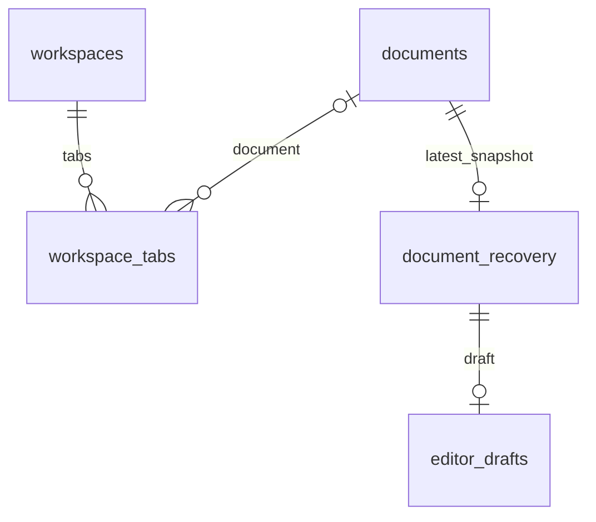

# Paperkit 데이터 저장 구조

확인일: 2026-11-14. 서버 마이그레이션과 로컬 개발 DB의 `PRAGMA table_info`를 대조했다. SQLite 스키마 버전 4, 테이블 7개다. 이번 도구 수정 API는 기존 행을 UPDATE하므로 새 마이그레이션이 필요하지 않다. 원격 서버의 현재 적용 버전은 별도 확인 대상이다.

로그인·계정은 Supabase Auth가 담당한다. 이 SQLite에는 비밀번호·로그인 사용자 테이블이 없으며, 인증한 사용자의 UUID를 `owner_id`로 사용한다. 소유권은 API 조회/수정 조건과 탭 소유권 트리거로 확인한다. 외부 Supabase 사용자 테이블과 SQLite 사이의 직접 외래키는 없다.

| 테이블              | 키와 주요 컬럼                                                                                                                                                             | 용도                                                                    |
| ------------------- | -------------------------------------------------------------------------------------------------------------------------------------------------------------------------- | ----------------------------------------------------------------------- |
| `documents`         | PK `id`; `owner_id`, `source_path`, `display_name`, `size_bytes`, `source_modified_at`, `source_hash`, `created_at`, `last_opened_at`, `favorite`                          | 계정별 문서 기록·검색·즐겨찾기. `(owner_id, source_path)` 유일          |
| `library_tools`     | PK `id`; `owner_id`, `name`, `kind`, `content`, `created_at`                                                                                                               | 재사용 이미지·문구·워터마크·전자서명. 수정 시 ID·종류·생성 시각 유지    |
| `workspaces`        | PK `id`; `owner_id`, `active_tab_id`, `revision`, `updated_at`                                                                                                             | 탭 묶음과 현재 활성 탭을 보관하는 서버 API용 구조                       |
| `workspace_tabs`    | 복합 PK `(workspace_id, id)`; `document_id`, `position`, `page_index`, `zoom`, `sidebar_open`                                                                              | 탭 순서와 문서별 화면 위치. 같은 묶음의 순서·문서는 중복 불가           |
| `document_recovery` | PK/FK `document_id`; `snapshot_pdf`, `snapshot_hash`, `source_hash`, `revision`, `format_version`, `updated_at`                                                            | 문서당 최신 복구 PDF 하나. PDF는 BLOB, 최대 32 MiB                      |
| `editor_drafts`     | PK `document_id`; `snapshot_hash`, `page_index`, `target_locator`, `original_text`, `draft_text`, `font_options`, `alignment`, `width`, `height`, `revision`, `updated_at` | 특정 복구 스냅샷에 대응하는 문구 수정 초안. locator·font_options는 JSON |
| `schema_migrations` | PK `version`; `checksum`, `applied_at`                                                                                                                                     | DB 변경 이력과 적용 파일 무결성                                         |

`workspaces.active_tab_id`는 같은 workspace의 탭을 가리키며 커밋 시 확인되는 복합 외래키다. `library_tools`는 문서와 독립적인 사용자별 데이터다. `documents`, `workspaces`, `library_tools`의 소유자를 통해 하위 데이터 접근을 제한한다. 소유자 없이 이전 버전에서 이관된 데이터는 로그인 사용자에게 자동 배정되지 않는다.

## 실제 저장 위치와 제한

- Docker DB: `/data/paperkit.sqlite3`, named volume `database`. WAL 모드·동기화 FULL·외래키 사용.
- 로컬 개발 DB: `.cache/dev-backend/paperkit.sqlite3`.
- 문서함은 원본 PDF의 경로 등 메타데이터를 기록한다. 목록 등록만으로 원본 PDF를 서버에 올리지는 않는다. 복구 PDF 저장은 별도 API다.
- 도구의 `content`: 문구/워터마크는 문자열, 이미지/서명은 `data:image/png;base64,...`. 계정당 최대 50개, PNG 원본 최대 1 MiB, 문구 최대 4,000자.
- 현재 데스크톱의 탭 복원은 PC의 `workspace.json`에 `workspace:<사용자 ID>` 키와 소유자 정보를 함께 저장한다. 비로그인 탭은 저장·복원하지 않는다. 이전 버전의 소유자 없는 `workspace` 키는 삭제하며 특정 계정에 자동 배정하지 않는다. 서버의 workspaces/recovery/draft 테이블이 존재한다고 모든 현재 편집 상태가 자동 동기화되는 것은 아니다.
- 문서함·도구함 조회는 TanStack Query의 계정별 메모리 캐시를 사용한다. 같은 쿼리의 동시 요청을 합치고 60초 동안 재사용하며, 추가·수정·삭제 시 무효화한다. 계정 변경·로그아웃 시 진행 중 요청을 취소하고 전체 목록 캐시를 비운다. 서버의 사용자 인증과 소유권 검사는 매 요청마다 유지한다.
- PDF 엔진의 실행 취소/다시 실행 이력은 열린 편집 세션의 메모리에서 관리하며 별도 SQL 이력 테이블은 없다.

스키마 원본: [001_core.sql](migrations/001_core.sql), [002_ownership.sql](migrations/002_ownership.sql), [003_library.sql](migrations/003_library.sql), [004_signature_tools.sql](migrations/004_signature_tools.sql).
