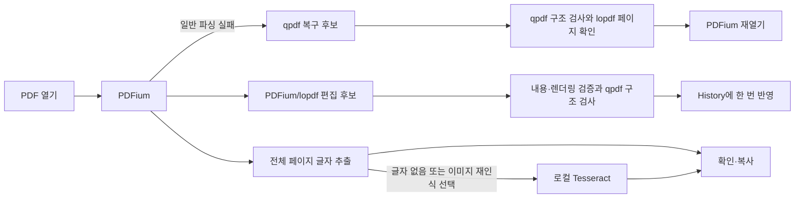

# Paperframe 앙상블 엔진

구현·검증일: 2026-11-14. PDFium/lopdf에 qpdf와 로컬 Tesseract OCR을 연결했다. 작업별 기본 경로, 제한된 대체 경로와 교차 검증으로 구성한다.

## 확인한 한계와 대응

| 기존 한계                                    | 이번 대응                                           | 남은 범위                                                                                       |
| -------------------------------------------- | --------------------------------------------------- | ----------------------------------------------------------------------------------------------- |
| PDFium이 거부하면 열기 종료                  | qpdf 복구 후보를 별도로 생성하고 재검사한 뒤 재열기 | 모든 손상 파일의 복구를 보장하지 않는다. 암호·권한·서명 제한은 우회하지 않는다.                 |
| 후보 재열기·렌더링 검증이 같은 PDFium에 의존 | qpdf 구조 검사도 통과한 바이트만 History에 반영     | 구조 검사만으로 시각적 동일성을 보장하지 않는다. 기존 텍스트·영역 밖 픽셀 보존 검사를 유지한다. |
| 스캔 페이지에는 텍스트 객체가 없음           | 페이지 이미지를 Tesseract로 읽어 확인·복사          | OCR 글자를 원본 편집 객체로 위장하거나 원본 글꼴·문단을 복원했다고 취급하지 않는다.             |
| Form XObject 내부 글자를 객체 선택에서 제외  | PDFium 전체 페이지 텍스트 추출로 읽기·복사          | 폼 내부 객체의 직접 편집은 아직 지원하지 않는다.                                                |
| subset 글꼴의 미포함 문자·복잡한 줄 재배치   | 기존 원본 글꼴 검증·명시적 글꼴 선택 유지           | qpdf/OCR로 원본 글꼴이 자동 복원되지는 않는다.                                                  |
| 엔진에 종속된 객체 ID와 캐시                 | 엔진 간에는 PDF 바이트·페이지 이미지만 전달         | 열린 편집 세션에 qpdf 복구를 적용하거나 객체 ID를 엔진끼리 공유하지 않는다.                     |

## 역할과 처리 경로

| 도구                            | 역할                                                        | 실행 시점                                                |
| ------------------------------- | ----------------------------------------------------------- | -------------------------------------------------------- |
| PDFium                          | 렌더링·객체/페이지 작업·전체 텍스트 추출·후보 재열기        | 기본 경로                                                |
| lopdf                           | 콘텐츠 스트림·리소스 보존 편집·복구 후보의 페이지 구조 확인 | 해당 편집과 복구 검증                                    |
| qpdf 12.4.2                     | 구조 검사·손상 문서 복구 후보                               | 편집 반영·저장 전 검사, 처음 열기 실패 시 복구           |
| Tesseract.js 7 / 한글·영문 모델 | 페이지 이미지의 문자 인식                                   | 글자가 없는 페이지, 사용자가 이미지 재인식을 선택한 경우 |

`engine/ensemble.rs`가 qpdf와 네이티브 열기를 조율한다. `History::apply`는 후보를 PDFium으로 다시 연 뒤 qpdf 검사까지 통과해야 revision과 Undo/Redo에 한 번 반영한다. 실패하면 문서와 이력을 유지한다. Save도 교차 검사 후 기존 원자적 새 파일 저장 경로를 사용한다.

이미지 삽입은 원본 페이지를 재생성하지 않고 별도 PNG XObject·콘텐츠 스트림을 추가한다. 이미지·서명·도형 이동/크기 조절은 소스 paint 연산자와 해당 전용 graphics-state 범위만 변환한다. 다른 연산자의 숫자·문자열·주석은 원본 바이트를 유지하며 인라인 이미지도 경계 검증 후 보존한다. 매핑할 수 없는 구조는 기존 후보 경로로 처리하고, 두 경로 모두 요청한 좌표·객체 수·변경 영역 밖 픽셀 검사를 유지한다.

텍스트 객체 변경과 짧은 문단 변경도 원본 인코딩으로 표현하고 영역을 보존할 수 있으면 해당 문자열 연산자만 수정한다. 다른 글꼴·문자 간격·정밀도를 재생성하지 않으며, 글자·서식·경계·다른 객체·픽셀 검증을 동일하게 적용한다. 도구함 진입 전 미반영 문구를 먼저 반영하고 실패하면 도구함을 열지 않아, 텍스트 오류가 이미지 오류로 가려지지 않도록 한다. 얇은 선의 좌표가 픽셀에서 0으로 반올림되는 경우에도 남은 축을 이용해 이동 좌표를 계산한다.

열기는 PDFium 우선이다. 비암호 오류 또는 빈 페이지 문서에서만 qpdf 복구를 시도한다. 암호화·서명 표식과 파싱 가능한 문서의 암호·서명 필드를 검사해 보수적으로 복구를 거부한다. 복구본은 qpdf로 재검사한 뒤 lopdf/PDFium 페이지 수를 비교하고 실제 페이지를 로드한다. 원본은 덮어쓰지 않으며 화면에 복구된 사본임을 표시한다. 읽지 못한 원본과의 시각적 동일성까지 입증한 것은 아니다.

qpdf는 shell 없이 고정 실행 파일과 고정 인자로 실행한다. 숨겨진 프로세스, 호출당 15초, 로그 1 MB, 후보 128 MB 제한과 임시 폴더 정리를 사용한다. 경고 코드 3은 복구 작업에서만 허용하며, 최종 검사는 코드 0이어야 통과한다. 도구가 없는 개발 환경에서는 기존 네이티브 검증을 사용한다. Windows 배포와 CI에는 qpdf를 포함한다.



## 글자 추출

`Paperframe::extract_text` / Tauri `extract_page_text`는 파일·revision·페이지와 추출 권한을 확인한다. 전체 페이지 텍스트가 유효하면 OCR을 실행하지 않는다. 텍스트가 없거나 깨진 문자 비율이 높은 경우 최대 1,600 × 2,200 px PNG를 넘긴다. 일부 글자만 있는 혼합 페이지는 **이미지에서 다시 읽기**로 OCR을 선택할 수 있다.

`lib/ensemble/read-page.ts`가 네이티브 결과와 OCR을 연결한다. worker·WASM·모델은 앱에 포함하며 CDN을 사용하지 않는다. 결과를 서버로 전송하지 않는다. 요청 시 시작, 90초 제한, 취소·늦은 결과 무시, 인식 후 worker 종료를 적용한다. 생성 중인 worker는 생성 완료 후 취소 여부를 확인해 정리한다. 실패 시 같은 페이지의 앞선 결과는 남기며 다른 페이지·revision의 결과는 재사용하지 않는다.

OCR은 확률적이다. 한글 본문·영문 fixture는 일치했지만 32 pt 한글 제목에서 `한`을 `안`으로 읽는 사례도 확인했다. 모델 교체만으로 이 사례가 해결되지는 않았다. confidence를 정답 확률이나 정확도 보증으로 표시하지 않으며 UI는 결과 확인을 안내한다.

두 단 문서가 한 블록으로 합쳐지는 문제를 줄이기 위해 자동 페이지 분석을 먼저 사용한다. 결과가 비었거나 confidence가 65보다 낮으면 단일 블록 방식으로 한 번 더 읽고 비어 있지 않은 후보 중 confidence가 높은 결과를 선택한다. 이 임계값은 재시도 정책이며 정확도 보증이 아니다.

## 리소스와 검증

### 편집 글꼴과 준비 성능

`editing/flow/font_plan.rs`는 글자별 스타일 배정 결과와 명시적 대체 글꼴 선택을 받아 글꼴 리소스를 계획한다. 같은 선택 글꼴은 필요한 문자 전체를 합쳐 Unicode coverage/embedding 권한을 확인한 뒤 PDFium에 한 번만 삽입한다. 원본 face/subset은 서로 합치지 않는다. 32개 원본 조각에 같은 대체 글꼴을 적용해도 FontFile2는 하나이며 저장·재열기·Undo 검증을 유지한다. PDFium 렌더·쓰기, lopdf 콘텐츠 보존, ttf-parser 글꼴 검증·복구, qpdf 구조 검사, OCR 읽기 경로의 책임을 분리한다.

`engine/session_cache.rs`는 세션/revision별 글꼴과 배경 이미지를 각각 24 MiB·12개 이내로 보관한다. 실패를 캐시하지 않고 편집·Undo/Redo·새 문서 로드에서 초기화하며 종료 시 해제한다. 캐시된 글꼴에도 새로 입력한 문자의 coverage를 검사한다. PNG 미리보기는 빠른 압축을 사용하고, 편집 진입 때 준비하던 후속 객체의 추가 레이어는 실제 문단 높이가 늘 때 준비한다.

브라우저 편집 화면은 원본 행의 위치 보정이 끝나기 전에 자동 줄바꿈하지 않는다. 첫 입력부터 원본 x 보정을 해제해 자연스럽게 줄바꿈한다. 줌은 PDF 재렌더 없이 크기와 transform만 갱신하고 휠 이벤트는 프레임 단위로 합치며 텍스트/객체 뷰를 재사용한다. 공개된 렌더 객체와 수정 이력은 줌에서 갱신하지 않는다.

`pnpm setup:engines`는 공식 qpdf 포터블 배포와 고정 commit의 한글·영문 모델을 SHA-256 확인 후 준비한다. 버전·출처·해시는 `scripts/ensemble-manifest.json`과 pnpm lock에 고정한다. 생성 파일은 git에 넣지 않는다. qpdf는 Tauri resource, OCR은 Vite public asset으로 배포한다. CI의 setup-node/setup-native와 웹 build에 준비 단계를 연결했다.

```powershell
pnpm setup:pdfium
pnpm setup:fonts
pnpm setup:engines
pnpm test:ensemble
pnpm test:corpus
pnpm test:stamps
cargo test -p pdf-core --locked --lib
```

`test:ensemble`은 실제 qpdf의 손상 xref 복구·잘못된 후보 거부, Form 읽기, 스캔 OCR 전달, revision 거부, 제한 문서의 OCR 차단, 로컬 한글·영문 인식을 검사한다. 기존 편집 corpus 23개와 워터마크·서명 통합 테스트도 qpdf 검증을 켠 상태에서 확인했다.

추가 회귀는 길이가 달라지는 객체·문단 변경에서 비대상 스트림 정밀도 보존, 특수 간격·stroke·공유 스트림·인라인 이미지 문서의 이미지/서명 삽입·이동·저장·되돌리기를 검사한다. 실제 로컬 문서는 원본을 저장하거나 테스트에 포함하지 않고 아래 opt-in runner로 확인한다.

```powershell
$env:PAPERKIT_EDIT_REGRESSION_PDF = 'C:\문서\sample.pdf'
cargo test -p pdf-core --locked --test editing_regressions -- --ignored --nocapture
```

참고: [qpdf CLI와 종료 코드](https://qpdf.readthedocs.io/en/stable/cli.html), [Tesseract.js 로컬 실행](https://github.com/naptha/tesseract.js/blob/master/docs/local-installation.md), [공식 OCR 모델](https://github.com/tesseract-ocr/tessdata_fast).
