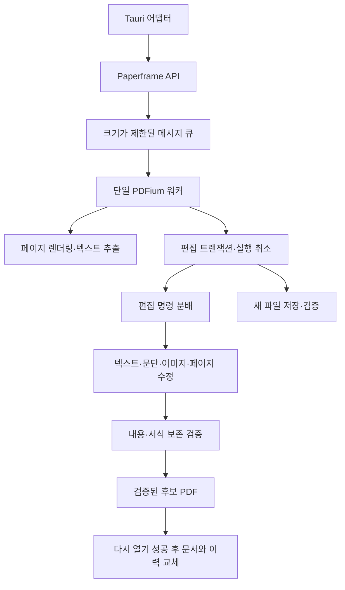

# Paperframe

Paperkit의 로컬 PDF 편집 엔진입니다. **Paper + Frame**은 문서의 원래 틀을 보존하며 내용을 편집한다는 의미입니다. PDFium을 사용하는 Rust 엔진이며 PDFium 자체를 새로 구현한 것은 아닙니다. Cargo 패키지명은 기존 연동을 위해 `pdf-core`를 유지합니다.

## 처리 흐름

## 모듈의 책임

| 위치                                         | 책임                                                         |
| -------------------------------------------- | ------------------------------------------------------------ |
| `engine/client.rs`                           | 앱에서 호출하는 API, 요청 전달과 응답 수신                   |
| `engine/protocol.rs`                         | 워커 메시지. PDFium 핸들을 전달하지 않음                     |
| `engine/worker.rs`                           | PDFium·현재 문서의 수명과 요청 처리 순서                     |
| `engine/raster.rs`                           | 비트맵·PNG 생성과 텍스트 좌표 추출                           |
| `editing/action.rs`                          | 직렬화 가능한 편집 명령과 상태                               |
| `editing/history.rs`                         | 버전 검사, 변경 반영, 실행 취소·다시 실행, 저장 상태         |
| `editing/dispatch.rs`                        | 명령을 수정 기능에 연결. 현재 문서와 이력을 직접 바꾸지 않음 |
| `editing/replace.rs`                         | 텍스트 객체·그룹 교체                                        |
| `editing/flow/`, `editing/block.rs`          | 문단 확장·재배치, 후속 객체 이동과 줄바꿈                    |
| `editing/graphics.rs`, `editing/movement.rs` | 이미지·도형 편집과 객체 이동·크기 변경                       |
| `editing/verification.rs`                    | 편집 전후 내용·서식 보존 검사                                |
| `content_stream/`                            | 원본 PDF 연산자 이동, 텍스트 교체와 간격 보존                |
| `document/`                                  | 파일 검사·선택, 페이지 작업과 안전한 저장                    |
| `text/`                                      | 텍스트 추출, 레이아웃 복원과 정렬                            |
| `fonts/`                                     | 제공·설치 글꼴 관리와 원본 글꼴 복원                         |
| `engine/error.rs`                            | 렌더링에 종속되지 않는 공통 엔진 오류                        |
| `compat/`                                    | 기존 `render`, `edit` 호출 경로를 유지하는 호환 모듈         |

## 유지해야 할 경계

- PDFium과 문서 핸들은 워커 스레드 안에서 생성하고 해제합니다. UI 스레드에서 동기 API를 호출하지 않습니다.
- 수정 기능은 후보 PDF 바이트를 반환합니다. 현재 문서·버전·실행 취소 이력의 변경은 `History`만 담당합니다.
- 후보 생성·검증·다시 열기 중 실패하면 현재 문서와 실행 취소 이력을 교체하지 않습니다.
- 명령별 보존 검사는 각 수정 기능과 `editing/verification.rs`에 있습니다. 검증을 제거해 편집 성공률을 높이지 않습니다.
- 새 편집 기능은 명령 정의, 분배, 검증과 회귀 테스트를 함께 추가합니다. Tauri IPC 타입을 엔진 내부로 가져오지 않습니다.
- 엔진 내부는 기능을 소유한 폴더의 경로를 사용합니다. 기존 공개 경로는 `lib.rs`의 재노출로 유지합니다. 전체 폴더 구조와 프론트엔드 경계는 [코드 구조](../../ARCHITECTURE.md)를 참고하세요.

## 검증

저장소 루트에서 `cargo test --workspace --locked`를 실행합니다. Windows PDFium 통합 검증은 `pnpm test:pdfium`, `pnpm test:corpus`, `pnpm test:fonts`로 실행합니다. PDFium 통합 테스트는 전역 초기화 충돌을 피하도록 테스트별 프로세스에서 실행합니다.
